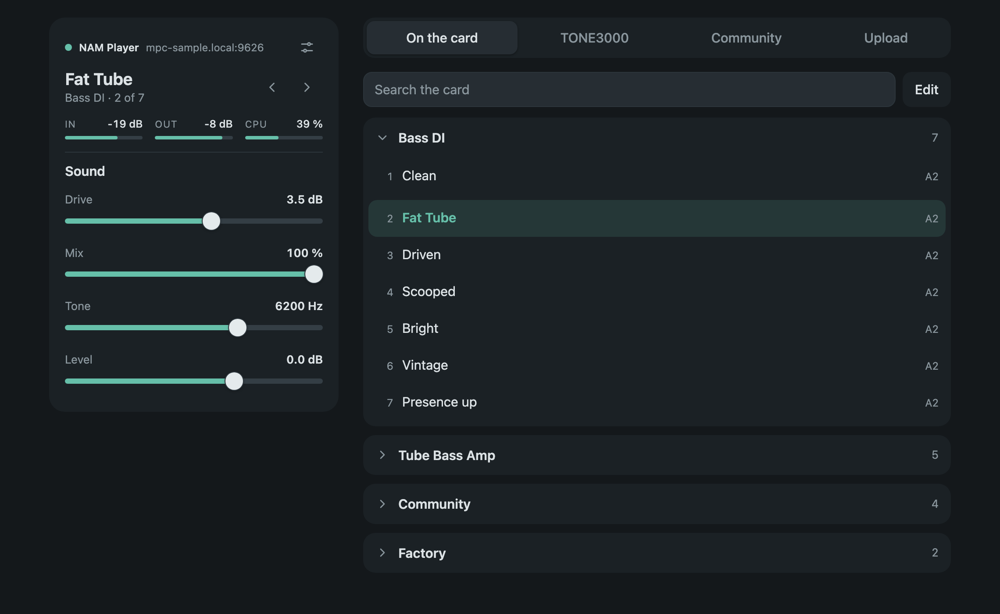
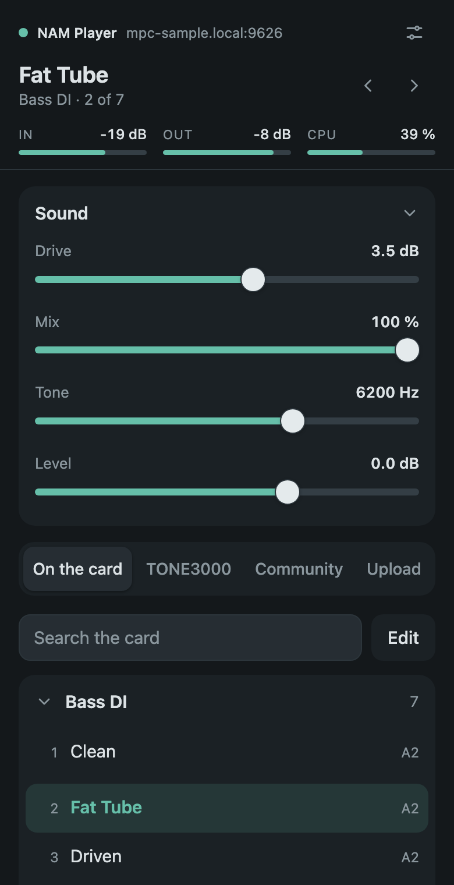
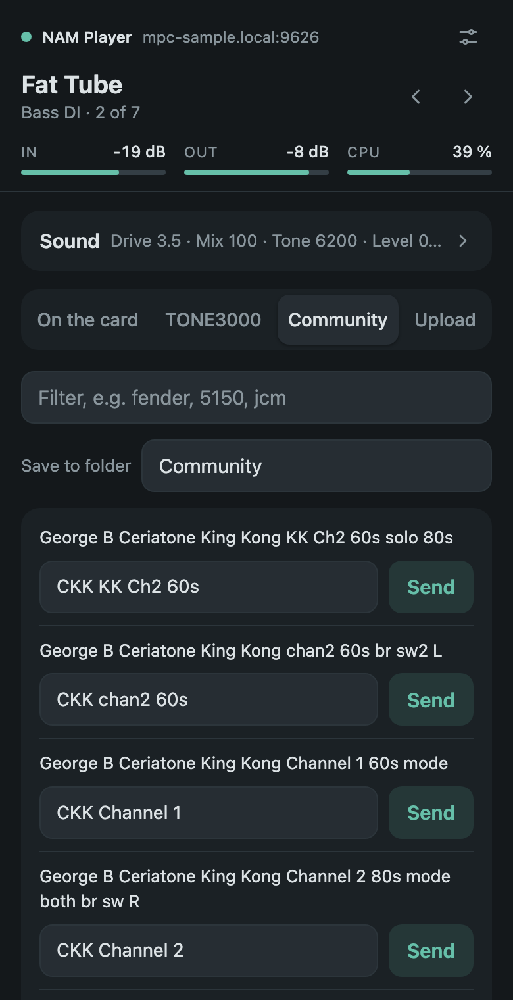
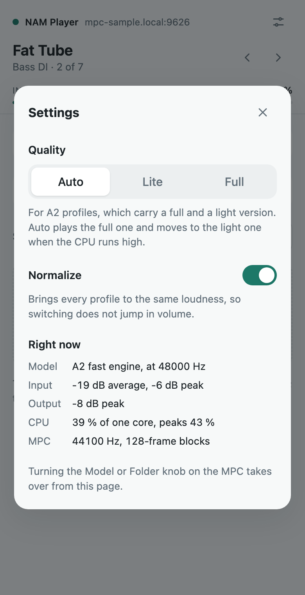

# NAM Player for Akai MPC

Play [Neural Amp Modeler](https://www.neuralampmodeler.com) captures of amps, pedals and
preamps as an insert effect on Akai MPC standalone hardware. Built for the **MPC Sample**,
where it runs as a Knob FX, with a web page served by the plugin itself over the USB-C
cable for everything the device has no screen for.



## What it does

- **Plays `.nam` profiles**: NAM **A2** (the 2026 architecture, including the Lite and Full
  versions inside one file) and the older **A1** WaveNet and LSTM profiles.
- **Browses the card with two knobs**: Model and Folder, plus Drive, Mix, Tone and Level.
- **Has a screen in your browser.** While the plugin is loaded, open
  `http://mpc-sample.local:9626` on the computer or phone at the other end of the USB-C
  cable: see what is playing, switch profiles, move the controls, watch levels and CPU.
- **Takes new profiles while it plays.** Send your own files, pick from a community
  collection of 259 captures, or browse TONE3000. They are saved to the card and start
  playing at once: no SD Card Access mode, nothing to eject.
- **Sounds like the reference.** Models run at their own 48 kHz through a resampler, and
  the output matches NeuralAmpModelerCore to better than -90 dB in the tests and on a real
  MPC Sample.
- **Looks after the MPC.** Loading happens off the audio thread with click-free switching,
  and a model that is too heavy for the CPU is dropped to its Lite version or bypassed.

<p align="center">
  
  
  
</p>

## Install

You need an MPC Sample with firmware **1.4.0 or later**. (Other MPCs need MPC OS 3.10.1
or later; the plugin is built for them but has not been run on one.)

1. Download the zip from the [latest release](../../releases/latest) and unzip it.
2. On the MPC Sample: MIDI Config → Dev Enhancements (Beta) → turn on **Dev Enhancements
   (Beta)**, then **Custom Plug-In Support**.
3. Connect the MPC to a computer with USB-C and enter **SD Card Access** mode from the
   Project screen. The card appears as a drive.
4. Copy the folder `Vazgen - VST - NAM Player` into a folder named `VST2 Plugins` at the
   top of the card (create it if it is not there).
5. Eject the card on the computer, leave SD Card Access mode, and restart the MPC.

NAM Player is now at the bottom of the FX Select list.

## Use it

**On the MPC Sample:** the knobs are Model, Drive, Mix. With SHIFT: Folder, Tone, Level.
Two demo profiles ship with the plugin in a folder called Factory.

**In a browser:** with NAM Player loaded and the USB-C cable connected, open
**http://mpc-sample.local:9626** (or http://192.168.155.1:9626) on the computer or phone.

| Tab | What it is for |
|---|---|
| On the card | Every folder and profile on the card. Tap one to play it; Edit to remove |
| TONE3000 | Sign in with your publishable API key, pick a tone on TONE3000, send its models |
| Community | 259 captures from [pelennor2170/NAM_models](https://github.com/pelennor2170/NAM_models) (GPL-3.0) |
| Upload | Your own `.nam` files, chosen or dropped anywhere on the page |

The device with the browser does the downloading, so it needs its own internet connection
for TONE3000 and the community collection. The plugin never connects out to anything, and
it listens only on the USB link.

Profiles live in `NAM Profiles` on the card, beside `VST2 Plugins`; each folder inside is
one position of the Folder knob. You can also copy files there by hand in SD Card Access
mode.

The [plugin's README](plugins/NAM%20Player/README.md) has the details: every control, the
card layout, how the link works and what it will not do, and how the audio path is built.

## CPU

A neural amp model is much heavier than an ordinary effect. Measured on an MPC Sample
(firmware 1.4.0.8): an A2 profile at full size takes about **39 % of one core**, with no
late blocks. A2-Lite and the small A1 sizes need less; A1 standard needs more. Prefer A2
profiles, and set Quality to Lite in the page's settings when you need headroom.

## Status

Working on one MPC Sample, firmware 1.4.0.8. Things to know before you rely on it:

- **TONE3000 sign-in from the page has not been run against the live service yet.** It is
  written from TONE3000's published API. The companion below is a second route.
- Not run on any other MPC model. The 32-bit ARM build has never been executed.
- No stereo processing (the model is mono, the dry signal stays stereo), no noise gate,
  no cabinet impulse loader, and no `.namb` files.

The full list is under "Not tested, not implemented" in the plugin's README.

## The companion

`companion/nam_card_loader.py` is a small web app for the computer the MPC is plugged
into, with no dependencies beyond Python 3. It does what the plugin's page does (TONE3000,
the community collection, your own files) and also works in SD Card Access mode, where it
writes straight to the mounted card and can install the plugin for you.

```
python3 companion/nam_card_loader.py      # then open http://localhost:8765
```

## Build from source

```
git clone https://github.com/inmusic-software/mpc-plugin-builder-sdk.git sdk    # once, into this folder
python3 build.py                  # -> plugins/NAM Player/build/Vazgen - VST - NAM Player/
python3 tests/run_tests.py        # audio against the NAM reference, latency, state, CPU guard (needs numpy, scipy)
python3 tests/test_link.py        # the live link, with audio running in real time
python3 tests/test_companion.py   # the companion against a stand-in TONE3000 and GitHub
sh tests/run_linux_arm.sh         # the real ARM64 library under Linux (Docker on an ARM64 computer)
```

The first build downloads the zig cross compiler into `sdk/.sdk-tools/` (about 50 MB).
Use `build.py` here, not the SDK's own: the NAM engines need C++20 and a C compile pass.

To check on the device that the plugin does what the NAM reference does:
`python3 tests/device/check_capture.py --profile <the .nam that is loaded> --record 8`
while something plays through it.

```
build.py                wrapper around the SDK's build (C++20, third-party engines)
plugins/NAM Player/     the plugin: src/, third_party/, Content/, plugin.json, ui.json
companion/              nam_card_loader.py and the file list of the community collection
tests/                  regression tests, the ARM Linux run, the on-device check
docs/screenshots/       the pictures on this page
```

## Credits and licences

This project's own code is [MIT](LICENSE). It is built with Akai's
[MPC Plugin Builder SDK](https://github.com/inmusic-software/mpc-plugin-builder-sdk) and
contains [NeuralAmpModelerCore](https://github.com/sdatkinson/NeuralAmpModelerCore) (MIT,
Steven Atkinson), [TONE3000's embedded A2 engines](https://github.com/tone-3000/embedded)
(MIT), [Eigen](https://gitlab.com/libeigen/eigen) (MPL-2.0) and
[nlohmann/json](https://github.com/nlohmann/json) (MIT); see
[third_party/README.md](plugins/NAM%20Player/third_party/README.md). Profiles you download
have their own licences: each source's creator and licence is written to an `ABOUT.txt`
beside the files.

Neural Amp Modeler is Steven Atkinson's project. This plugin is not affiliated with it,
with TONE3000 or with Akai Professional. "MPC" and "Akai Professional" are trademarks of
inMusic Brands, Inc.
